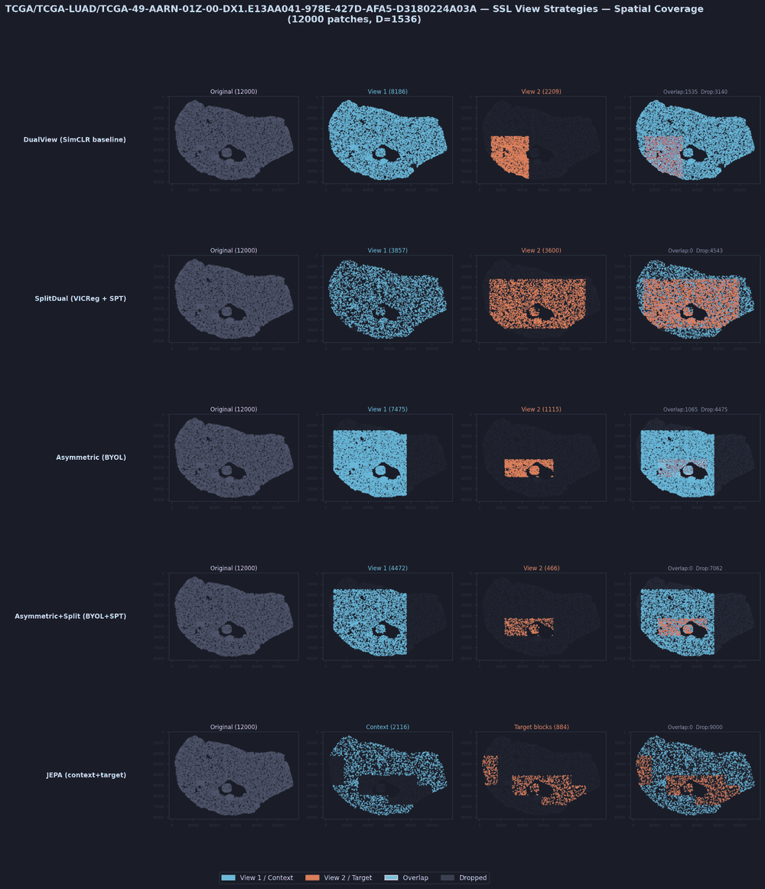
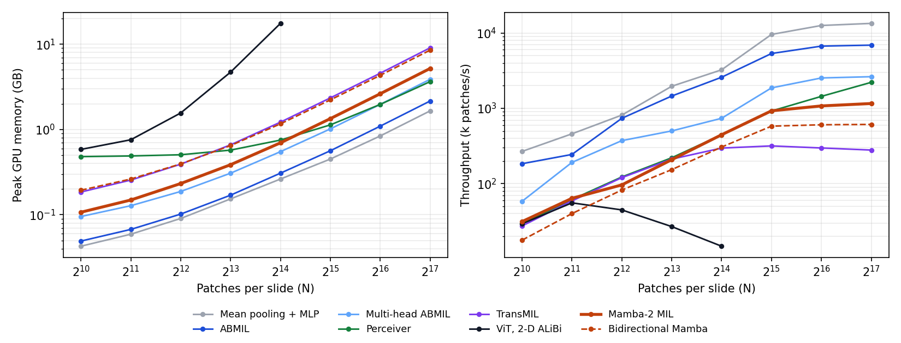

# OceanPath

[](https://github.com/Lyce24/OceanPath/actions/workflows/ci.yml)


Self-supervised pretraining of slide-level multiple-instance learning (MIL) aggregators for
computational pathology, and the pipeline around it: feature stores, supervised fine-tuning,
label-efficiency probes, export, and a CPU serving image.

OceanPath pretrains Mamba-2 MIL aggregators without labels on UNI2-h patch features of
**14,529 public TCGA and CPTAC whole-slide images (142.7 million patches)** with four
slide-level objectives (VICReg, JEPA, LeJEPA, LeJEPA-MC), then measures what that pretraining
buys on public downstream tasks against strong supervised baselines: TCGA-NSCLC subtyping with
CPTAC-NSCLC as an external cohort, colorectal BRAF mutation, and PANDA prostate grading.

<p align="center">
  
</p>

## Contents

- [Results](#results): fine-tuning, label efficiency, pretraining compute, scaling, serving latency
- [Install](#install) · [Data layout](#data-layout) · [Reproduce](#reproduce) · [Serve](#serve)
- [Pretrained weights](#pretrained-weights) · [Documentation](#documentation) · [License](#license)

## Results

Every table below is regenerated from finished runs by `make results` (with `OCEANPATH_ROOT`
set); each row names the command that produced it. Patient-level metrics throughout. Folds are
fixed (5-fold, patient-grouped, stratified); the seed changes initialisation, data order and,
for probes, which patients are labelled.

### Fine-tuning

ABMIL and Mamba-2 MIL trained from scratch, and Mamba-2 MIL fine-tuned from each SSL checkpoint
(aggregator learning rate 1e-5, head 1e-4). Mean ± SD over seeds of the pooled out-of-fold
metric, a 95% patient-bootstrap CI of the seed-averaged predictions, and the paired difference
to Mamba-2 MIL from scratch. CPTAC-NSCLC is scored by the five TCGA fold models, averaged.

<!-- results:supervised -->
<!-- /results:supervised -->

### Label efficiency

Frozen slide embeddings, logistic-regression probes trained on 1–100% of the training patients
(three random draws per fraction; at 100% one), against three pooling baselines and a
randomly initialised Mamba-2 aggregator with the same architecture.

<p align="center">
  
</p>

<!-- results:label-efficiency -->
<!-- /results:label-efficiency -->

### Pretraining compute

From the Weights & Biases run records (`scripts/pretraining_compute.py`; every run in
`results/pretraining/compute.csv`). GPU-hours are wall-clock hours times GPUs.

| Objective | Hardware | Epochs | Wall-clock | GPU-hours |
| --- | --- | --- | --- | --- |
| VICReg | 1× RTX A5000 (workstation) | 100 | 26.0 h | 26.0 |
| JEPA | 2× RTX A5000 (Brown CCV Oscar) | 100 | 10.1 h | 20.1 |
| LeJEPA | 2× RTX A5500 (Brown CCV Oscar) | 100 | 9.2 h | 18.3 |
| LeJEPA-MC | 2× RTX 3090 (Brown CCV Oscar) | 100 | 10.5 h | 21.1 |
| **The four checkpoints** | | | | **85.5** |
| All 85 logged pretraining runs (development, ablations, failures) | | | | **602** (Oscar 336, workstation 266) |

### Memory and throughput versus bag size

One slide per step, bf16 autocast, UNI2-h features (1,536 dims), RTX A5000 (24 GB)
(`scripts/benchmark_scaling.py`). Attention pooling, the Perceiver, TransMIL's Nyström attention
and Mamba-2 scale linearly in the number of patches; the TITAN-style ViT builds an N × N
distance matrix for its 2-D ALiBi bias and runs out of memory past 16,384 patches.

<p align="center">
  
</p>

<!-- results:scaling -->
<!-- /results:scaling -->

### Serving latency (CPU)

p50 / p95 milliseconds per slide through the server's inference backend, and the HTTP round
trip of the serving image's endpoints (`scripts/benchmark_serving.py`; random weights, which do
not change latency). JSON bodies cost about ten bytes per value, so large bags go through
`POST /predict/npy`.

<!-- results:serving -->
<!-- /results:serving -->

## Install

OceanPath uses [uv](https://docs.astral.sh/uv/) and the committed `uv.lock` (Python 3.10–3.12).

| Use | Command | Needs |
| --- | --- | --- |
| Everything except the Mamba-2 kernels (training of attention models, probes, export) | `make sync` | CPU is enough |
| Mamba-2 aggregators | `make sync-gpu` | NVIDIA GPU and `nvcc`; compiles `mamba-ssm` and `causal-conv1d` once (about 25 min) |
| Feature extraction from whole-slide images | `uv sync --extra extract` | TRIDENT, OpenSlide |
| Serving only, without torch | `docker build -f docker/serve.Dockerfile -t oceanpath-serve .` | Docker |

`mamba-ssm` publishes no wheels for torch 2.8 or later, so the `mamba` extra builds its kernels
against the locked torch. All Mamba imports are guarded: without the extra those models are
simply not registered, and everything else installs and tests on a laptop. `make ci` runs the
same lint, lockfile, test and build steps as GitHub Actions.

## Data layout

Every storage root derives from one environment variable (`configs/platform/local.yaml`);
`configs/platform/example.yaml` is a template for machines whose slides, features and outputs
live in different places.

```text
$OCEANPATH_ROOT/
  features/UNI2_h_features/{TCGA,CPTAC,PANDA}/   per-slide patch features (H5)
  manifests/                                     label and pretraining manifests
  splits/<dataset>/kfold5_seed42/                fold assignments
  mmap/<dataset>/                                chunked feature stores
  checkpoints/aggregator_weights_<method>.pt     SSL checkpoints for fine-tuning and probes
  outputs/                                       runs, sweeps, reports
```

The public-cohort manifests were derived from TCGA/CPTAC metadata and the PANDA challenge
labels; UNI2-h features come from MahmoodLab's gated release.

## Reproduce

```bash
export OCEANPATH_ROOT=/path/to/oceanpath-data

# Feature stores and folds (once per dataset)
python scripts/build_mmap.py data=tcga_nsclc encoder=uni2h storage.filter_by_csv=true
python scripts/make_splits.py data=tcga_nsclc encoder=uni2h splits=kfold5

# Pretraining (Slurm template; one objective per job)
sbatch slurm/pretrain.sbatch model=mamba2mil pretrain_training=lejepa_2c

# Fine-tuning tables: tasks x initialisations x seeds
bash scripts/run_supervised_baselines.sh --task nsclc --seeds "42 43 44"

# Label efficiency: pooling baselines, random init and every SSL checkpoint
bash scripts/run_label_efficiency.sh --task nsclc_xfer \
  --ssl-ckpt vicreg=$OCEANPATH_ROOT/checkpoints/aggregator_weights_vicreg.pt \
  --ssl-ckpt lejepa=$OCEANPATH_ROOT/checkpoints/aggregator_weights_lejepa.pt

# Systems and serving benchmarks
python scripts/benchmark_scaling.py --out results/scaling
python scripts/benchmark_serving.py --out results/serving_latency

# Tables, figures and this README's result blocks
make results
```

`slurm/` has job templates for pretraining, fine-tuning and the probe sweep. On this
project's workstation only one CUDA process may run at a time (concurrent processes trigger
driver faults under WSL2), so the drivers take `--jobs 1` there.

## Serve

`scripts/export_model.py` exports a trained checkpoint to ONNX and TorchScript, checks both
against PyTorch on several bag sizes, and writes a model card; an export whose check fails or
cannot run is reported as failed. The CPU image serves the ONNX artifact with no torch
installed:

```bash
make demo-artifact                       # random-weight ABMIL, for trying the API
docker build -f docker/serve.Dockerfile -t oceanpath-serve .
docker run --rm -p 127.0.0.1:8000:8000 -v "$PWD/artifacts/demo:/models:ro" oceanpath-serve

curl -s http://127.0.0.1:8000/health
python - <<'PY'
import io, numpy as np, urllib.request
x = np.random.randn(8000, 1536).astype(np.float32)        # one slide's patch features
buf = io.BytesIO(); np.save(buf, x)
print(urllib.request.urlopen(urllib.request.Request(
    "http://127.0.0.1:8000/predict/npy", buf.getvalue())).read())
PY
```

Endpoints: `GET /health`, `GET /model-card`, `POST /predict` (JSON `[N, D]`),
`POST /predict/npy` (`.npy` body; pickled arrays are refused) and `POST /predict/batch`.
Malformed bags (wrong feature dimension, empty, non-finite) are 400s. Without Docker:
`python -m oceanpath.serving --artifact-dir artifacts/demo --threads 4`.

## Pretrained weights

The four Mamba-2 MIL checkpoints are not published yet. UNI2-h and its feature release are
licensed CC-BY-NC-ND 4.0, and MahmoodLab counts models trained on their outputs as derivatives
that may not be used commercially without approval. `scripts/publish_pretrained_weights.py`
stages a gated, non-commercial Hugging Face release (safetensors, config, model card) for when
that is cleared.

## Documentation

- [Pipeline reference](docs/pipeline.md): stages, the DAG engine, SSL objectives and
  augmentations, aggregators, linear probing and its robustness rules, typical commands
- [Slurm templates](slurm/README.md)
- `configs/`: Hydra groups for data, encoders, models, training, SSL objectives, splits and platforms

## License

Code: MIT. Model weights trained on UNI2-h features follow UNI2-h's CC-BY-NC-ND 4.0 terms.
